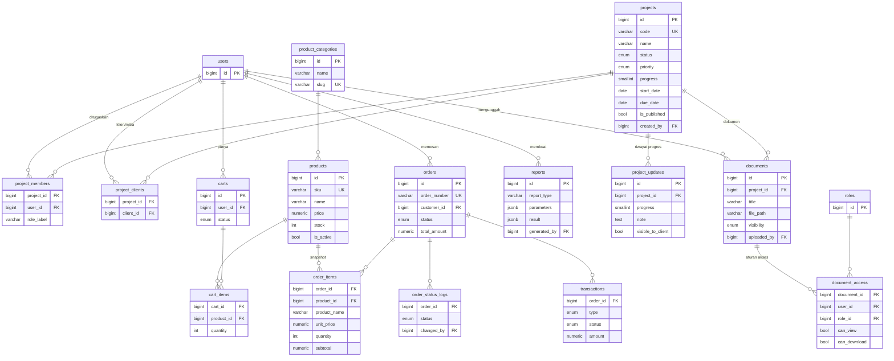

# ERD — Modul Business Operations (Gisel)

Tabel bertanda **(Nuneu)** dimiliki modul User & Partner; di sini hanya sebagai referensi FK.

## Catatan keputusan

| Keputusan | Alasan |
|---|---|
| `order_items` menyimpan `product_name` dan `unit_price` | Harga saat pesan tidak berubah walau produk diedit (skenario uji dokumen SIP). |
| `projects.is_published` | Penanda data yang boleh diberikan ke Devina untuk portofolio; data internal tidak otomatis publik. |
| `project_updates.visible_to_client` | Klien/mitra hanya melihat progres yang diizinkan. |
| `products.stock` boleh NULL | Pengelolaan stok belum diputuskan; NULL = tidak dikelola (cocok untuk layanan). |
| `transactions` generik | Pembayaran online belum diputuskan perusahaan. |
| Soft delete (`deleted_at`) | Dokumen SIP menyarankan arsip untuk data penting. |
| `order_status_logs` (tabel tambahan) | Tidak ada di dokumen awal; dibutuhkan agar riwayat status terlihat — boleh dibuang bila tim tidak setuju. |
